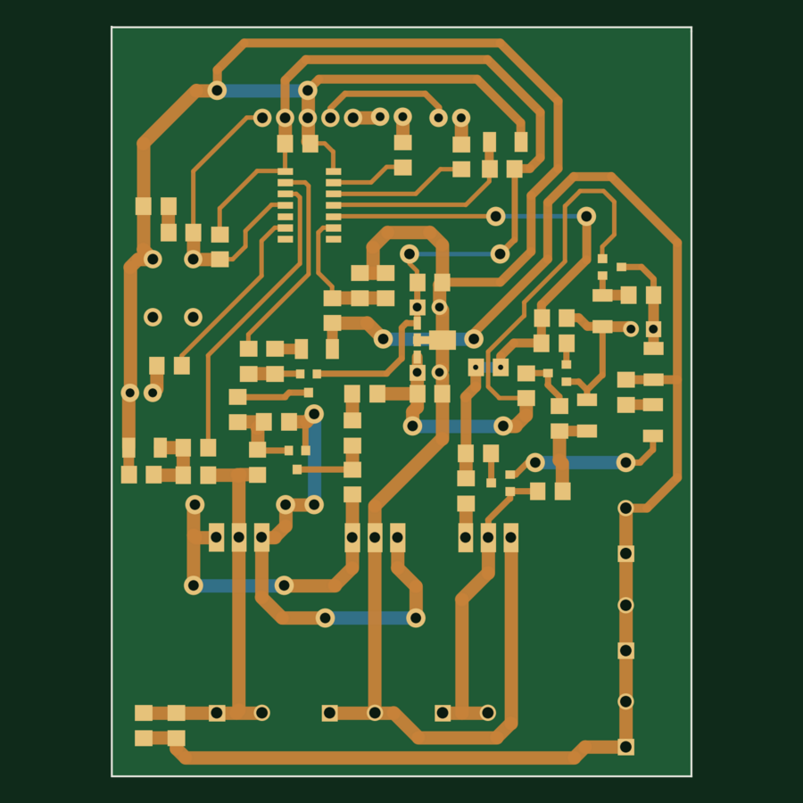

# Heavy-Duty Solar Charge Controller

A solar charge controller for a **24 V, 100 Ah** battery bank, built around a **PIC16F676** microcontroller with 60 V / 40 A **TK40E06N1** power MOSFETs and wide copper for high charging currents. The MCU monitors the panel and battery, switches the charge path, and powers a switchable DC load. Back-to-back MOSFETs stop the battery draining into the panel at night. Developed at Shriji Technoaspire in 2022.



*2-layer, 65 × 84 mm (rendered from the KiCad layout)*

---

## Key specs

| | |
|---|---|
| **Battery** | 24 V, 100 Ah |
| **MCU** | Microchip PIC16F676 (14-pin SOIC, 10-bit ADC) |
| **Power switches** | 3 × Toshiba TK40E06N1 N-MOSFETs (60 V, 40 A, TO-220) |
| **Switching** | Low-side, common-positive (panel, battery and load share +ve) |
| **Reverse blocking** | Back-to-back MOSFET pair on the solar input |
| **Logic supply** | Transistor and Zener pre-regulator into a 78L05 5 V regulator |
| **Connections** | Screw terminals for solar, battery and load; 5-pin programming/status header |
| **Indicators** | 3 status LEDs, reset button |
| **PCB** | 2 layers, 65 × 84 mm, power traces up to 1.5 mm, KiCad 6 |

## How it works

```
 Solar +ve ─────────────────────────┬────────────────────┬──────── Load +ve
                                    │                    │
                                Battery +ve          PIC16F676 ◄── voltage sense
                                    │                    │
 Solar -ve ──[M3]◄►[M2]── Battery -ve ──[M1]── Load -ve  │
              charge switch          load switch         │
                  ▲                       ▲              │
                  └──── gate drive ───────┴──────────────┘
```

**Charge path.** M2 and M3 are N-MOSFETs with their sources tied together, placed between the panel and battery negatives. Back to back, their body diodes face opposite ways, so when they're off no current flows in either direction. This blocks the battery from discharging into the panel at night, which a single MOSFET can't do. A transistor driver (Q5, Q6) switches the shared gate, and a 12 V Zener (Z2) clamps the gate-source voltage.

**Load path.** M1 switches the load negative. Its gate is driven by the PIC through a 100 Ω gate resistor, so the MCU can disconnect the load. The output is general-purpose and was used with different DC loads, not only lighting.

**Sensing.** Resistor dividers bring the battery and panel voltages into the PIC's analog inputs.

**Supply.** The 78L05 is fed from the battery through a Zener-referenced transistor pre-regulator (Q2, Z3). The 12 V Zener drops the 24 V battery to a safe input for the 78L05, which gives the MCU a clean 5 V rail.

**Firmware.** The PIC16F676 firmware is not included in this repository.

**Layout choices.**
- Through-hole TO-220 MOSFETs for current handling.
- High-current paths routed as 1.0–1.5 mm traces.
- The MCU and sensing circuitry sit at the opposite end of the board from the power terminals.

## Repository structure

```
Solar_Charger/
├── hardware/
│   ├── Solar_Charge_Controller.kicad_pro   KiCad 6 project
│   ├── Solar_Charge_Controller.kicad_sch   Schematic
│   ├── Solar_Charge_Controller.kicad_pcb   PCB layout
│   ├── Solar_Charge_Controller_BOM.csv     Bill of materials
│   └── fabrication/                        Gerbers + drill files (.zip)
└── docs/images/                            Board render
```

Open `hardware/Solar_Charge_Controller.kicad_pro` in **KiCad 6** or newer.

## Tools

KiCad 6 · Microchip PIC16F676

## Acknowledgements

Thanks to **Dhruvil Patel**, my supervisor at Shriji Technoaspire, for mentoring me through this project.

## License

No license is granted. This repository is shared as a portfolio of my work; all rights reserved.

---

**Smit Vaghela** — Embedded Software / Firmware Engineer · [GitHub](https://github.com/smit2400)
